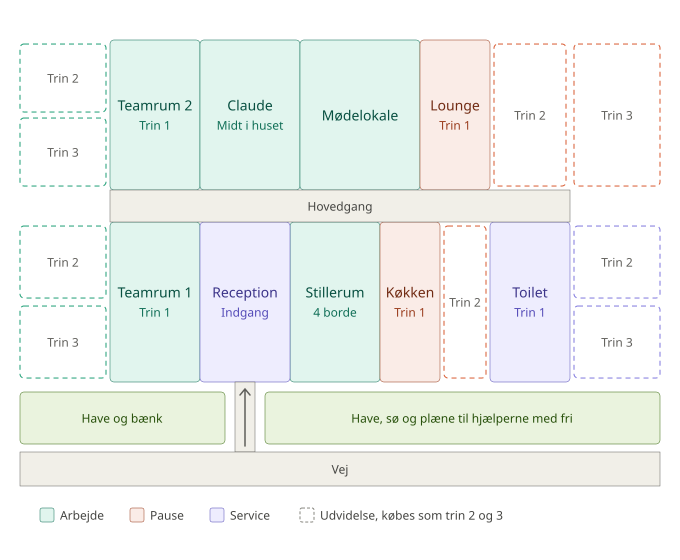

# Ny grundplan for kontoret

Status: **aftalt som plan, ikke bygget endnu.** Tegningen er forslag 3 fra vores snak den 16. oktober 2026; de åbne spørgsmål står nederst.

## Hvorfor

Det nuværende kontor er vokset rum for rum, og det kan ses:

- **Ingen gange.** Man går gennem rummene for at komme rundt, fx gennem teamrummet for at nå køkkenet, så hjælperne går mellem skrivebordene.
- **For tæt på vejen.** Toilettet og mødelokalet ligger helt ned til hækken, så intet kan vokse mod syd. Det var her, ønsket om et større toilet gik i stå.
- **Tingene ligger tilfældigt.** Receptionen stikker ud på siden, pauserne er spredt, og Claude sidder i et hjørne langt fra den nye halvdel af huset.

## Idéen

- **En hovedgang** på tværs af huset. Alle rum har dør ud til gangen, så hjælperne går på gangen og ikke gennem rummene.
- **To rækker rum.** Mod nord: teamrum 2, Claude, mødelokalet og loungen. Mod syd: teamrum 1, receptionen, stillerummet, køkkenet og toilettet.
- **Receptionen midt på forsiden** med stien lige ned til vejen. Claude sidder lige over den, midt i huset, så hjælperne har kort vej med deres resultater, og mødelokalet ligger ved siden af Claude.
- **Have mellem huset og vejen.** Hele bygningen rykker væk fra vejen, så der er plads til bænken, plænen og søen foran.
- **Rum, der vokser.** Fem rum starter små og kan udvides i trin: teamrummene mod vest, loungen og toilettet mod øst, køkkenet inde i bygningen. Udvidelserne ude på grunden kræver, at grunden er købt.
- **Alt i ét plan.** Ingen etager; kontoret vokser kun ud over grunden.

## Rummene og deres trin

| Rum | Trin 1 | Trin 2 | Trin 3 |
|---|---|---|---|
| **Teamrum 1** | Plads til 3 skriveborde | 6 skriveborde, mod vest | 9 skriveborde, ud på grunden mod vest |
| **Teamrum 2** | Plads til 3 skriveborde | 6 skriveborde, mod vest | 9 skriveborde, ud på grunden mod vest |
| **Køkken** | Kaffemaskine og et lille bord, 2 pladser | Stort bord, køleskab og snackautomat, 5 pladser | (ingen trin 3) |
| **Lounge** | Sofa og spillekonsol | Pool-bord og dartskive | Ud på grunden mod øst: bar, jukebox og arkademaskine |
| **Toilet** | Én bås | To båse og en håndvask | Tre båse, ud på grunden mod øst |

Uden trin: Claudes kontor, mødelokalet, receptionen (står altid; købet indretter den) og stillerummet med 4 borde.

Skrivebordene købes stadig ét ad gangen; et teamrums trin giver pladsen til dem. Med alt udbygget er der 9 + 9 + 4 = 22 skriveborde mod 16 i dag. Hvert trin hæver trivslen lidt, og prisen stiger for hvert trin (fx det dobbelte af forrige trin).

## Når den bygges

- **Ingen mister noget.** Et gemt spil flyttes over til den nye plan: købt køkken bliver køkken trin 1, toilet bliver toilet trin 1, loungen bliver lounge trin 1, teamrum 2 bliver teamrum 2 trin 2 (det havde 6 borde), og teamrum 1 starter på trin 2, fordi det allerede har plads til 6. Købte skriveborde og pynt beholdes.
- **Sofahjørnet og bordtennisbordet** står i dag i teamrummet. De flytter ind i loungen eller bliver til en del af dens trin.
- **Grundplanen ligger kun i `public/js/plan.js`** (`ROOM_TYPES`, `PLAN`, `GROUNDS`). Trinene bliver nye ting i serverens priser, og rummenes størrelse følger af det købte trin.
- **Ruterne skal tjekkes** i hver kombination af trin, med `kontorCheckRoutes()` og `tests/page.test.mjs`.

## Åbne spørgsmål

1. Er 3, 6 og 9 skriveborde pr. trin rigtigt, eller skal teamrummenes trin 3 give noget andet, fx en sofa eller en tavle?
2. Køkkenet ligger i den sydlige række, langt fra loungen. Er det okay, eller skal de bytte, så pauserne er samlet?
3. Skal stillerummet blive ved med ikke at kunne udvides?
4. Hvor meget skal hvert trin koste, så det stadig tager uger at bygge kontoret helt ud?
